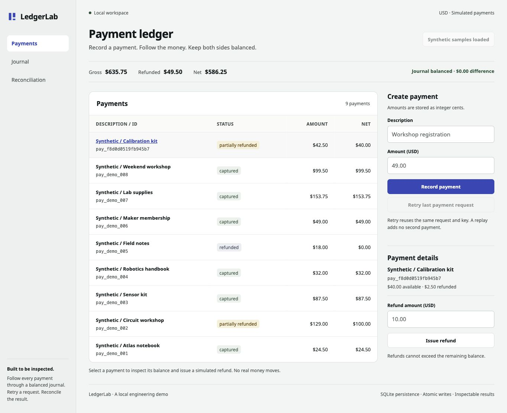
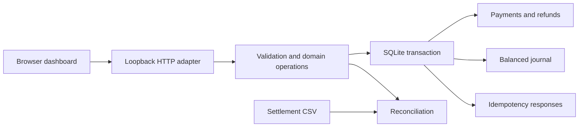

# LedgerLab

A local payments ledger for exploring the parts of a money-moving system that must stay correct: duplicate requests, partial refunds, balanced accounting, and settlement reconciliation.

**Demo only:** amounts are synthetic USD cents. LedgerLab does not connect to Stripe, access a bank, or move money. It has no accounts or authentication and binds to `127.0.0.1` only.



## Run

Requires **Python 3.11 or newer**. There are no third-party Python packages, API keys, build tools, or paid services to set up.

```bash
python3 -m ledgerlab.server --port 8011
```

Open [http://127.0.0.1:8011](http://127.0.0.1:8011). Use **Load sample payments** to add eight synthetic payments and two refunds. The button is non-destructive: if any payments already exist, it leaves them untouched.

The SQLite database persists at `data/ledger.sqlite3` and is excluded from Git. To try a separate dataset without changing the existing one:

```bash
python3 -m ledgerlab.server --port 8012 --db data/another-demo.sqlite3
```

## Try the failure cases

1. Create a payment, then repeat the request with the same idempotency key. The second result is a replay; no additional payment or accounting entries appear.
2. Reuse that key with a different amount. The server rejects it with HTTP `409`.
3. Make a partial refund. Try refunding more than the remaining balance. The second operation fails atomically.
4. Reconcile the supplied sample CSV. It deliberately contains one changed amount and omits one payment.
5. Export the journal. Each transaction has two equal and opposite entries, and the signed total is zero.

## Why these decisions matter

| Decision | Reason | Tradeoff |
| --- | --- | --- |
| Integer cents; USD only | Avoid floating-point rounding inside the ledger | No FX, currencies with other minor units, or fractional-cent fees |
| Append-only payments, refunds, and journal | Corrections become new records instead of silently changing history | This demo has no generalized reversal workflow |
| SQLite `BEGIN IMMEDIATE` | The idempotency check and writes share a lock and commit; concurrent refunds cannot overspend the refundable balance | One database writer at a time |
| Idempotency fingerprint + stored response | Repeating a request reproduces its original result; a key cannot silently change meaning | Keys never expire; the response is a historical snapshot |
| Explicit read transaction | Payments, entries, and totals describe one consistent snapshot | Large histories should eventually use pagination |
| Exact CSV matching | Settlement anomalies are visible instead of being silently normalized away | The importer requires one documented format |

### Accounting example

For a `2500`-cent payment, cash receives a `+2500` debit and merchant payable receives a `-2500` credit. A `500`-cent refund posts `-500` to cash and `+500` to merchant payable. The payable represents funds owed to the merchant; it is not treated as the platform's revenue.

The demo intentionally omits payment authorization, processor fees, payouts, disputes, and bank settlement timing. Reconciliation compares each CSV row with a payment's **current net amount**, so use a snapshot exported at the same point in time.

## Architecture



`ledgerlab/core.py` owns accounting and reconciliation. `ledgerlab/server.py` adapts HTTP requests and serves `web/`. Every database connection is explicitly closed. The standard-library test suite runs against temporary databases and a temporary HTTP server.

## HTTP API

All POST requests use `Content-Type: application/json`. Payment/refund mutations also require `Idempotency-Key` (1-128 letters, digits, dots, underscores, colons, or hyphens). A new successful mutation returns `201`; a replay returns `200` with `replayed: true`. Domain errors return `{ "error": "code", "message": "Explanation" }`.

| Method | Route | Body / result |
| --- | --- | --- |
| GET | `/api/state` | Payments, journal entries, totals, sample CSV |
| POST | `/api/payments` | `{ "amount_cents": 2500, "description": "Notebook" }` |
| POST | `/api/payments/{id}/refunds` | `{ "amount_cents": 500 }` |
| POST | `/api/reconcile` | `{ "csv": "payment_id,net_cents,currency\n..." }` |
| GET | `/api/export` | Download journal CSV |
| POST | `/api/demo/seed` | `{}`; seed only an empty ledger |
| GET | `/api/health` | `{ "status": "ok", "mode": "local-demo" }` |

```bash
curl http://127.0.0.1:8011/api/payments \
  -H 'Content-Type: application/json' \
  -H 'Idempotency-Key: notebook-001' \
  -d '{"amount_cents":2500,"description":"Notebook"}'
```

Run that same command again to observe replay behavior. Changing `2500` to `2600` while keeping `notebook-001` produces a conflict. To create a different payment, use a new key.

For a refund, replace `PAYMENT_ID` with the returned payment ID:

```bash
curl http://127.0.0.1:8011/api/payments/PAYMENT_ID/refunds \
  -H 'Content-Type: application/json' \
  -H 'Idempotency-Key: refund-001' \
  -d '{"amount_cents":500}'
```

### Settlement CSV format

```csv
payment_id,net_cents,currency
pay_demo_001,2450,USD
pay_demo_002,10000,USD
```

Headers and order must match exactly. The importer accepts a UTF-8 BOM, at most 2,000 rows, and at most 256,000 UTF-8 bytes. Amounts are non-negative integer cents up to `100000000`.

Findings are `matched`, `mismatched`, `missing`, `unknown`, `duplicate`, or `invalid`. Differences are **actual minus expected**. Duplicate rows are reported, not summed. An invalid row for a known payment also leaves that payment missing because no usable settlement record was supplied. Reconciliation is read-only; it never changes the journal.

## Tests

```bash
python3 -m unittest discover -s tests -v
```

The tests verify money conservation, per-transaction balance, atomic rollback, persistent replay, concurrent duplicate requests, concurrent refund limits, immutable records, malformed CSV, and HTTP validation. CI runs the same suite on Python 3.11-3.13.

## Scope and next steps

This is a single-user educational system, not a payment processor or production accounting service. It has no tenant isolation, authentication, distributed coordination, backups, idempotency expiry, or schema migration framework. Local requests are size-limited and checked for Host/Origin; that is not a substitute for production access control. Do not expose this development server to the public internet.

The dashboard retains retry keys in the current page's memory. Use its retry control after an uncertain response before reloading or closing the page; a reload discards that client-side intent. The server's idempotency records remain durable.

Useful extensions, each with a testable goal:

- Add pagination and verify stable ordering while new records arrive.
- Introduce separate processor-clearing and payout accounts; test their balances independently.
- Add reconciliation batch IDs and an as-of timestamp without mutating existing accounting records.
- Add a property-based test harness that generates random payments/refunds and checks conservation after every step.
- Measure concurrent request latency and explain SQLite's write-lock tradeoff using your own recorded results.

See [the walkthrough](docs/walkthrough.md) for a short demo and questions to practice explaining.

## Development note

The initial implementation was developed with AI assistance. Its tests, decisions, and limitations are documented for review. The sample business activity is synthetic; no customer usage or production performance is claimed.

## References

- [SQLite transactions](https://www.sqlite.org/lang_transaction.html)
- [SQLite write-ahead logging](https://www.sqlite.org/wal.html)
- [Stripe's idempotent request design](https://docs.stripe.com/api/idempotent_requests) informed the learning exercise; LedgerLab is not an implementation of Stripe's API.
